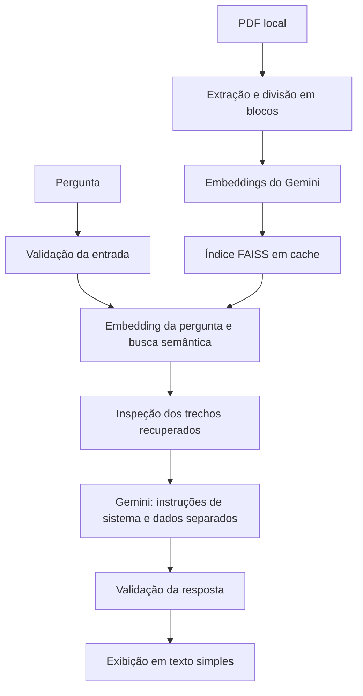

# Assistente RAG de Políticas Internas

Aplicação de perguntas e respostas sobre documentos de RH, construída com **Python, Streamlit, LangChain, Google Gemini e FAISS**. O projeto combina busca semântica em um PDF com geração de respostas em português e guardrails para reduzir riscos de prompt injection.

## Visão geral

Em vez de enviar o PDF inteiro ao modelo de conversa a cada pergunta, a aplicação recupera até quatro trechos relacionados à consulta. O Gemini recebe esses trechos como contexto e é instruído a responder com base no documento, citar as páginas disponíveis e reconhecer quando faltam informações.

O projeto demonstra um fluxo de **RAG — Retrieval-Augmented Generation** com separação entre interface, orquestração e validação de conteúdo.

### Funcionalidades

- Consulta a um PDF de políticas internas por meio de uma interface de chat.
- Extração de texto e divisão em blocos de 1.000 caracteres, com sobreposição de 200.
- Embeddings do Gemini e busca semântica local com FAISS.
- Cache do banco vetorial em memória para evitar reindexação a cada interação.
- Validação de perguntas, contexto recuperado e respostas.
- Histórico visual da conversa durante a sessão.
- Exemplo alternativo com OpenAI, separado da aplicação principal.

## Como funciona



Perguntas bloqueadas pela validação não seguem para a busca ou para o modelo de conversa. Se os trechos recuperados contiverem padrões de instruções suspeitas, a geração é interrompida.

## Tecnologias

| Tecnologia | Papel no projeto |
| --- | --- |
| Python 3.12 | Linguagem e versão usada no desenvolvimento |
| Streamlit | Interface de chat e cache de recursos |
| LangChain | Composição do fluxo de recuperação e geração |
| Google Gemini | Modelo de conversa e embeddings |
| FAISS | Índice vetorial em memória |
| PyPDF | Leitura do PDF |
| unittest | Testes locais com respostas simuladas |

## Executar localmente

### 1. Preparar o ambiente

Baixe ou clone este repositório e abra um terminal na pasta do projeto. Com Python 3.12 instalado, crie e ative o ambiente virtual:

**Linux / macOS**

```bash
python3.12 -m venv .venv
source .venv/bin/activate
```

**Windows — PowerShell**

```powershell
py -3.12 -m venv .venv
.venv\Scripts\Activate.ps1
```

Instale as dependências:

```bash
python -m pip install -r requirements.txt
```

### 2. Configurar a API

Crie uma chave no [Google AI Studio](https://aistudio.google.com/apikey) e copie o arquivo de configuração:

```bash
# Linux / macOS
cp .env.example .env
```

```powershell
# Windows — PowerShell
Copy-Item .env.example .env
```

Edite o `.env`:

```dotenv
GOOGLE_API_KEY=sua_chave_aqui
GEMINI_MODEL=gemini-3.8-flash
GEMINI_EMBEDDING_MODEL=gemini-embedding-001
```

Esses são os modelos configurados por padrão. As variáveis permitem utilizar outros modelos disponíveis no seu projeto, respeitando a finalidade de conversa ou embeddings. A execução requer acesso à internet e está sujeita às cotas da API.

### 3. Adicionar o documento

Coloque um PDF com texto selecionável em:

```text
data/politica_rh.pdf
```

O repositório não distribui o PDF de consulta nem o material de estudo. Documentos digitalizados como imagem precisam passar por OCR antes do uso; o aplicativo não realiza essa etapa.

### 4. Iniciar a aplicação

```bash
streamlit run app_basic.py
```

Abra o endereço exibido pelo Streamlit e faça perguntas relacionadas ao documento, por exemplo:

- “Como solicitar férias?”
- “Quais são as regras para trabalho remoto?”
- “O documento prevê auxílio para cursos?”

As respostas dependem do conteúdo do PDF fornecido.

## Estrutura do repositório

```text
.
├── app_basic.py             # Interface e configuração da aplicação Gemini
├── rag.py                   # Fluxo de busca, geração e validação
├── guardrails.py            # Política, limites e filtros de conteúdo
├── requirements.txt         # Dependências da aplicação principal
├── .env.example             # Modelo de configuração sem credenciais
├── .gitignore               # Exclusão de segredos, dados locais e caches
├── data/
│   └── README.md            # Instruções para adicionar o PDF local
├── docs/
│   ├── GUARDRAILS.md        # Política de proteção e limitações
│   └── README.md            # Orientações para material de estudo local
├── examples/
│   ├── app_openai.py        # Implementação de referência com OpenAI
│   └── requirements.txt     # Dependências adicionais do exemplo
└── tests/
    └── test_guardrails.py   # Testes de validação e do fluxo RAG
```

## Guardrails e prompt injection

A aplicação principal utiliza camadas de proteção:

| Camada | Controle |
| --- | --- |
| Entrada | Pergunta não vazia, até 2.000 caracteres e detecção de padrões suspeitos após normalização Unicode |
| Recuperação | Inspeção dos trechos do PDF e limite de 12.000 caracteres de texto de contexto |
| Prompt | Mensagem de sistema separada dos dados da pergunta e do PDF, serializados em JSON |
| Saída | Limite de 6.000 caracteres e bloqueio de padrões conhecidos de credenciais, instruções suspeitas, links HTTP/HTTPS e HTML/imagens |
| Interface | Exibição em texto simples, sem interpretação de Markdown ou HTML |

O modelo não recebe ferramentas para executar comandos, navegar na internet ou ler arquivos locais. As chaves são usadas para autenticação nas APIs e não são incluídas no prompt.

**Esses controles reduzem o risco, mas não garantem proteção completa contra prompt injection.** Filtros por padrões podem gerar falsos positivos e deixar passar ataques novos ou ofuscados. A fidelidade das respostas, o respeito ao escopo de RH e as citações de páginas dependem também do modelo; não há verificação automática de cada afirmação.

A política completa, o escopo dos controles e suas limitações estão em [docs/GUARDRAILS.md](docs/GUARDRAILS.md).

## Testes

Com o ambiente virtual ativo, execute:

```bash
python -m unittest discover -s tests -v
```

Os testes cobrem perguntas legítimas, padrões de injeção direta e no contexto do PDF, limites de tamanho, separação das mensagens e validação da saída. Também verificam que entradas bloqueadas não chegam às etapas seguintes.

A suíte utiliza respostas simuladas, não consome a API e não exige uma chave real. Ela verifica os controles locais; não mede a resistência do Gemini a ataques reais.

## Cache, cotas e dados

- **Embeddings do PDF:** gerados durante a criação do banco vetorial e reutilizados enquanto o cache estiver disponível. Reiniciar o servidor ou alterar os blocos do documento, a chave ou o modelo de embeddings exige nova indexação.
- **Embeddings da pergunta:** cada pergunta aceita gera uma consulta ao serviço de embeddings para localizar os trechos relevantes.
- **Modelo de conversa:** recebe a pergunta e os trechos aprovados pelos guardrails. O histórico exibido na interface não é enviado como memória da conversa.
- **Persistência:** o índice e o cache ficam em memória; não são salvos em disco.
- **Privacidade:** o texto do PDF é enviado ao serviço de embeddings na indexação. Perguntas e trechos recuperados são enviados à API durante as consultas. A inspeção do contexto não substitui a revisão do documento antes do uso.

O `.gitignore` exclui `.env`, ambientes virtuais, PDFs, dados locais e índices vetoriais. O `.env.example` contém apenas o modelo de configuração.

## Solução de problemas

| Situação | O que verificar |
| --- | --- |
| Chave não configurada | Preencha `GOOGLE_API_KEY` no `.env` da raiz do projeto e reinicie o app. |
| PDF ausente | Adicione o arquivo com o nome `data/politica_rh.pdf`. |
| PDF sem texto extraído | Verifique se o texto é selecionável; aplique OCR caso o documento seja uma digitalização. |
| Erro 404 no modelo | Confira o identificador e a disponibilidade do modelo de conversa ou embeddings na sua conta. |
| Erro 429 de cota | Aguarde a renovação do limite indicado pela API e consulte as [cotas no Google AI Studio](https://ai.dev/rate-limit). |
| Pergunta ou documento bloqueado | Revise a mensagem apresentada e os padrões definidos em `guardrails.py`. Perguntas legítimas também podem acionar filtros. |

## Exemplo alternativo com OpenAI

A implementação em `examples/app_openai.py` mantém o fluxo original com OpenAI para conversa e embeddings. Ela utiliza o mesmo PDF local, mas **não incorpora o cache nem os guardrails da aplicação Gemini**.

Preencha `OPENAI_API_KEY` no `.env` e execute:

```bash
python -m pip install -r examples/requirements.txt
streamlit run examples/app_openai.py
```

## Escopo

Este é um projeto de estudo e demonstração local de RAG. A aplicação consulta um único PDF compartilhado e não implementa autenticação, autorização por usuário, isolamento de documentos ou limitação de requisições por usuário. Esses recursos precisam ser considerados antes de disponibilizá-la para uso com documentos internos em um ambiente compartilhado.
